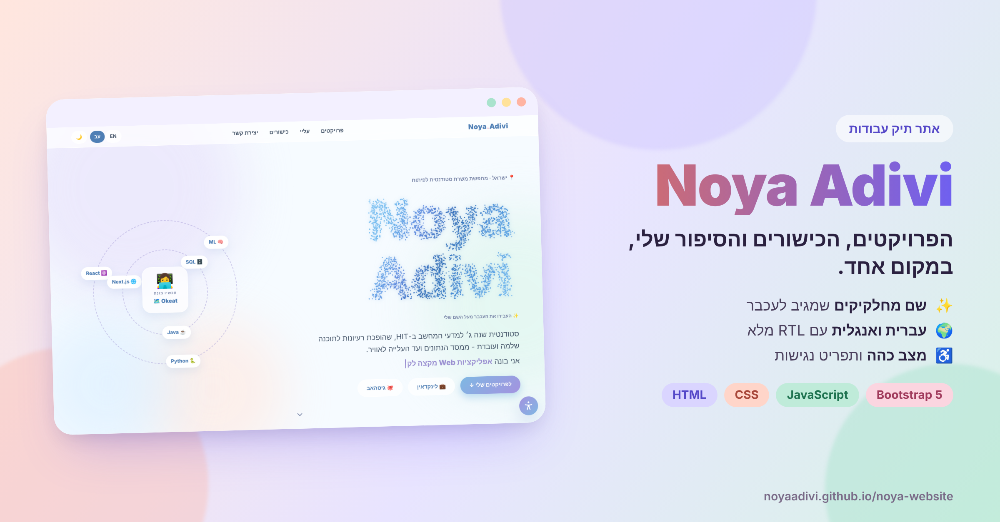

<div dir="rtl">

<p align="center">
  <a href="https://noyaadivi.github.io/noya-website"></a>
</p>

<p align="center"><a href="README.md"></a></p>

<p align="center">
  <a href="https://noyaadivi.github.io/noya-website"></a>
  <a href="index.html"></a>
  <a href="https://www.linkedin.com/in/noya-adivi/"></a>
</p>

<p align="center">
  <a href="LICENSE"></a>
  <a href="https://github.com/NoyaAdivi/noya-website/commits/main"></a>
  <a href="https://github.com/NoyaAdivi/noya-website"></a>
  <a href="https://github.com/NoyaAdivi/noya-website"></a>
</p>

<h3 align="center">פרויקטים, כישורים וקצת עליי, במקום אחד.</h3>

<p align="center">
  עיצוב פסטלי רך, שם מחלקיקים שמגיב לעכבר, ותפריט נגישות מלא.
</p>

<p align="center">
  <a href="https://noyaadivi.github.io/noya-website"></a>
</p>

<table align="center">
  <tr>
    <td align="center" width="25%"><a href="#s1"><b>🚀 7</b></a><br><sub>פרויקטים באתר</sub></td>
    <td align="center" width="25%"><a href="https://noyaadivi.github.io/noya-website"><b>🌍 HE · EN</b></a><br><sub>דו־לשוני עם RTL</sub></td>
    <td align="center" width="25%"><a href="https://noyaadivi.github.io/noya-website"><b>🌙 Dark</b></a><br><sub>מצב כהה</sub></td>
    <td align="center" width="25%"><a href="index.html"><b>📄 1</b></a><br><sub>קובץ אחד, בלי build</sub></td>
  </tr>
</table>

<a name="s1"></a>
<p align="center"><a href="https://noyaadivi.github.io/noya-website/#projects"></a></p>

- 🗺️ **[Okeat](https://github.com/NoyaAdivi/Okeat)** - מפה דו-לשונית של 20,000+ מקומות אוכל · [לאתר](https://okeat.vercel.app)
- 🏨 **[DiviStay](https://github.com/NoyaAdivi/DiviStay)** - הזמנת מלון קבוצתית עם פיצול תשלום · [לאתר](https://divistay.onrender.com)
- 🖼️ **[Sort Photos](https://github.com/NoyaAdivi/sort-photos)** - מסווג תמונות AI שעובד בלי אינטרנט
- 🎭 **[Emotion Detection](https://github.com/NoyaAdivi/emotion_detection_ml)** - Naive Bayes מאפס לזיהוי 6 רגשות
- 💬 **[TCP Chat](https://github.com/NoyaAdivi/Networking-project)** - צ'אט מרובה משתמשים וניתוח ב-Wireshark

<a name="s2"></a>
<p align="center"><a href="index.html"></a></p>

- 🎨 **שם אינטראקטיבי מחלקיקים** שמגיב לעכבר
- 🌍 **עברית ואנגלית** עם תצוגה מלאה מימין לשמאל
- 🔍 **הצצה לעומק** ל-Okeat ול-DiviStay: הבעיה, איך זה עובד וההחלטות המרכזיות
- 🗂️ **סינון פרויקטים** וכרטיסים שנפתחים לאתר החי או לקוד
- 🌙 **מצב כהה** לפי הגדרות המחשב
- ♿ **תפריט נגישות:** גודל טקסט, ניגודיות גבוהה, גופן קריא ועצירת אנימציות
- 📱 **מותאם** לטלפון ולמסך רחב

<a name="s3"></a>
<p align="center"><a href="https://getbootstrap.com"></a></p>

קובץ `index.html` אחד עם HTML, CSS, JavaScript ו-Bootstrap 5, באחסון GitHub Pages, בלי שלב בנייה.

<a name="s4"></a>
<p align="center"><a href="LICENSE"></a></p>

```bash
git clone https://github.com/NoyaAdivi/noya-website.git
```
ואז פותחים את `index.html` בדפדפן.

<a name="contact"></a>
<p align="center"><a href="https://www.linkedin.com/in/noya-adivi/"></a></p>

<p align="center">
  <a href="https://noyaadivi.github.io/noya-website"></a>
  <a href="https://www.linkedin.com/in/noya-adivi/"></a>
  <a href="https://noyaadivi.github.io/noya-website"></a>
  <a href="https://github.com/NoyaAdivi"></a>
</p>

</div>
