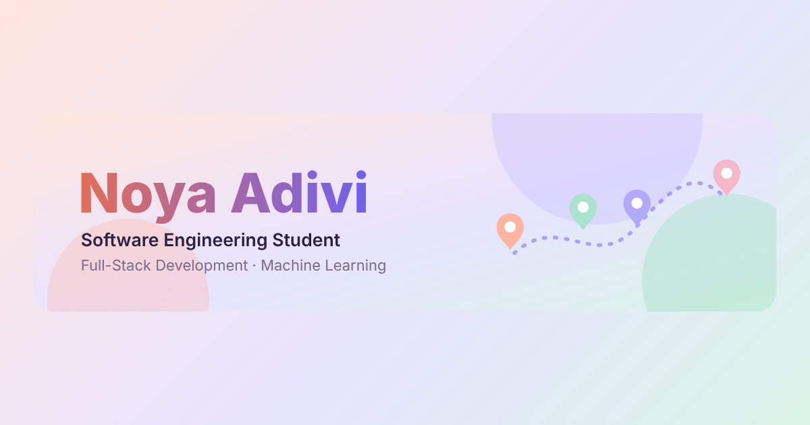

<div dir="rtl">

<h1 align="center">🌸 נויה אדיבי · תיק עבודות</h1>

<p align="center"><a href="README.md">English</a> · <b>עברית</b></p>

<p align="center">
  האתר האישי שלי: פרויקטים, כישורים וקצת עליי,<br>
  בעיצוב פסטלי רך, בעברית ובאנגלית.
</p>

<p align="center">
  <a href="https://noyaadivi.github.io/noya-website"></a>
</p>

<p align="center">
  <a href="https://noyaadivi.github.io/noya-website"></a>
</p>

## 🚀 הפרויקטים באתר
- 🗺️ **[Okeat](https://github.com/NoyaAdivi/Okeat)** - מפה דו-לשונית של 20,000+ מקומות אוכל · [לאתר](https://okeat.vercel.app)
- 🏨 **[DiviStay](https://github.com/NoyaAdivi/DiviStay)** - הזמנת מלון קבוצתית עם פיצול תשלום · [לאתר](https://divistay.onrender.com)
- 🖼️ **[Sort Photos](https://github.com/NoyaAdivi/sort-photos)** - מסווג תמונות AI שעובד בלי אינטרנט
- 🎭 **[Emotion Detection](https://github.com/NoyaAdivi/emotion_detection_ml)** - Naive Bayes מאפס לזיהוי 6 רגשות
- 💬 **[TCP Chat](https://github.com/NoyaAdivi/Networking-project)** - צ'אט מרובה משתמשים וניתוח ב-Wireshark

## ✨ מה יש באתר
- 🎨 **שם אינטראקטיבי מחלקיקים** שמגיב לעכבר
- 🌍 **עברית ואנגלית** עם תצוגה מלאה מימין לשמאל
- 🔍 **הצצה לעומק** ל-Okeat ול-DiviStay: הבעיה, איך זה עובד וההחלטות המרכזיות
- 🗂️ **סינון פרויקטים** וכרטיסים שנפתחים לאתר החי או לקוד
- 🌙 **מצב כהה** לפי הגדרות המחשב
- ♿ **תפריט נגישות:** גודל טקסט, ניגודיות גבוהה, גופן קריא ועצירת אנימציות
- 📱 **מותאם** לטלפון ולמסך רחב

## 🛠️ טכנולוגיות
קובץ `index.html` אחד עם HTML, CSS, JavaScript ו-Bootstrap 5, באחסון GitHub Pages, בלי שלב בנייה.

## 💻 הרצה מקומית
```bash
git clone https://github.com/NoyaAdivi/noya-website.git
```
ואז פותחים את `index.html` בדפדפן.

## 📬 בואו נדבר
💼 [LinkedIn](https://www.linkedin.com/in/noya-adivi/) · 🐙 [GitHub](https://github.com/NoyaAdivi) · 🌐 [לאתר](https://noyaadivi.github.io/noya-website)

</div>
