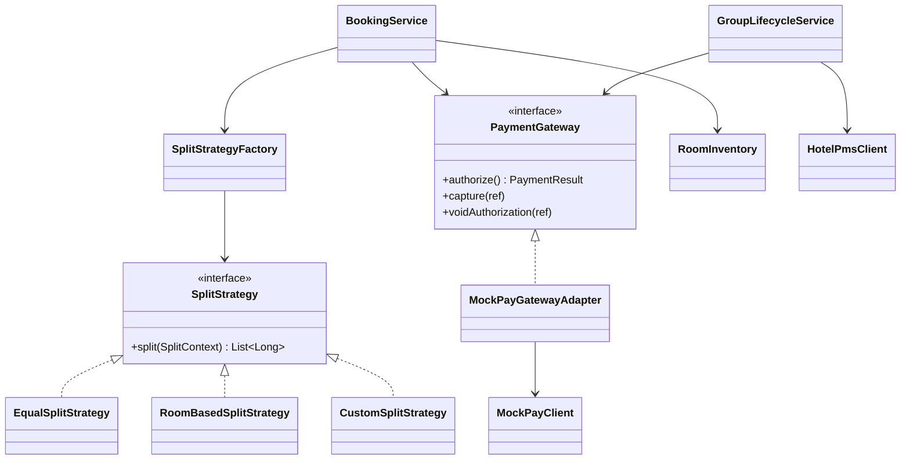

<p align="center"></p>

<h1 align="center">DiviStay</h1>

<p align="center"><b>English</b> · <a href="README.he.md">עברית</a></p>

<p align="center"><b>Group hotel booking with payment splitting.</b><br>
The organizer picks the rooms, everyone pays their own share from a personal link, and the booking is confirmed only when the whole group has paid.</p>

<p align="center"><a href="https://divistay.onrender.com"><b>Live demo</b></a> · <a href="docs/">Architecture &amp; requirements (PDF)</a></p>

<p align="center"></p>

<p align="center"><sub>Demo project: payments, rooms, prices and reviews are simulated. The first load can take about 30 seconds.</sub></p>


---

This project started as a **software architecture and requirements** project (SRS, UML, design patterns – see [`docs/`](docs/)) and was then **implemented in Java 21 + Spring Boot**, following the same design.

## How it works

1. **Search & lock** – the organizer chooses rooms; they are held for **30 minutes** so nobody else can book them (overbooking protection).
2. **Split** – the cost is divided **equally**, **by room** (people in a suite pay more) or with **custom amounts**.
3. **Pay** – each member gets an unguessable personal payment link. Paying *authorizes* (holds) the amount on their card.
4. **Confirm** – when 100% is paid, the reservation is sent to the hotel. On success the holds are *captured* and receipts are sent; if the hotel's system is down, the request is **retried with exponential backoff**.
5. **Cancel automatically** – if time runs out (or the hotel never confirms), the rooms are released and every hold is **voided**: nobody is charged.

## Design patterns

| Pattern | Where | Why |
|---|---|---|
| **Strategy** | `SplitStrategy` → `EqualSplitStrategy`, `RoomBasedSplitStrategy`, `CustomSplitStrategy` | The booking logic doesn't know how the cost is split; a new split rule is one new class. |
| **Factory** | `SplitStrategyFactory`, `RoomFactory` | One place decides which strategy to use and how each room type is built (capacity, price). |
| **Adapter** | `PaymentGateway` ← `MockPayGatewayAdapter` → `MockPayClient` | The core talks to its own payment interface; switching providers means writing a new adapter. |
| **Ports & adapters** | `HotelPmsClient`, `NotificationService`, repositories | The core has **no Spring dependencies**; Spring only wires it together (`AppConfig`). |



## Engineering details

- **Real hotels:** over 18,000 real hotels in 60 destinations and 21 countries, from OpenStreetMap (ODbL): name, address, location, and stars when known. Rooms, prices and reviews are simulated (there is no access to real availability), and the photos match the kind of place: city, seaside, Greek island or resort.
- **Search by city or country,** in Hebrew or English, and a destinations page by country.
- **Search like a real booking site:** adults, children with their ages, and how many people split the bill. For every hotel the cheapest set of rooms that sleeps the whole group is found (a small knapsack), with the price per payer. Filters for stars, rating, price and facilities, sorting and pages.
- **Concurrency:** holding rooms is atomic and all-or-nothing; a test races 32 threads for one room and checks that exactly one wins. Payments and the background job lock the same group, so they can never act on it at the same moment.
- **Money:** stored as whole agorot (`long`), never floating point. Splits always add up exactly – leftover agorot are assigned deterministically.
- **Security:** payment and dashboard links are 256-bit random tokens; only their SHA-256 hashes are stored. Card details are never stored and are masked in logs.
- **Idempotency:** the same member paying with the same card twice (double click, retry) can never be charged twice.
- **State machine:** `BookingGroup` only allows valid transitions (collecting → funded → confirmed / retrying / cancelled).
- **Two languages:** English and Hebrew (right-to-left) with Spring `MessageSource`; the browser language is detected and the choice is remembered. Messages produced by the core are localized in the web layer (`Translator`), so the business logic stays language-neutral.
- **Accessibility:** an accessibility menu (text size, high contrast, highlighted links, readable font, stop animations, big cursor), keyboard navigation with a skip link, labelled form groups, WCAG AA colour contrast and an accessibility statement. Respects the system "reduce motion" setting.
- **Dark mode:** follows the system setting and can be switched by hand; the choice is applied before the page paints.
- **Legal pages:** privacy policy, terms of use and accessibility statement, in both languages.
- **Tests:** JUnit 5 – split rules, inventory locking and concurrency, the full life cycle (expiry, retries, give-up and refund), the payment adapter, and an end-to-end web test with MockMvc.

## Run it

**Windows, no setup:** double-click `START-DIVISTAY.bat`. It finds Java 21+ on the computer, downloads Maven the first time, starts the site and opens the browser. `TEST-DIVISTAY.bat` runs all the tests.

Requirements: **Java 21 or newer**. Or with **IntelliJ IDEA**:

1. `File → Open` and choose this folder (the one with `pom.xml`). Wait for Maven to download the libraries.
2. Open `src/main/java/com/divistay/DiviStayApplication.java` and click ▶ **Run**.
3. Go to **http://localhost:8080**.

Or from a terminal with Maven installed: `mvn spring-boot:run`, and `mvn test` for the tests.

**Try it:** create a group with 2–3 emails → open the payment links from the *Messages sent* box on the dashboard → pay with test card `4242 4242 4242 4242` (any future date, any CVC). `4000 0000 0000 0002` is declined. To watch the automatic cancellation quickly, set `divistay.payment-window-minutes=2` in `src/main/resources/application.properties`.

## Project structure

```
src/main/java/com/divistay/
├── domain/      BookingGroup, GroupMembership, Hotel, Room, RoomFactory, DateRange, Money…
├── split/       SplitStrategy + 3 strategies + SplitStrategyFactory
├── payment/     PaymentGateway, MockPayGatewayAdapter, MockPayClient, CardDetails
├── inventory/   RoomInventory (locking / overbooking protection)
├── hotel/       HotelPmsClient, SimulatedHotelPms
├── notify/      NotificationService, OutboxNotificationService
├── repo/        repository interfaces + in-memory implementations
├── security/    SecureTokens
├── service/     BookingService, GroupLifecycleService
└── web/         Spring MVC controllers, scheduler, configuration
docs/            SRS and Software Architecture Document (UML)
```

## Deploy

DiviStay is a Java server, so it doesn't run on Vercel. The simplest host is [Render](https://render.com), which has a free plan:

1. Push the project to a GitHub repository.
2. On Render, sign in with GitHub, choose **New → Blueprint** and pick the repository. `render.yaml` sets everything up, and Render builds the site from the `Dockerfile`.
3. After a few minutes the site is live at an address like `https://divistay.onrender.com`.

On the free plan the server sleeps after 15 minutes without visitors, and the first visit after that takes about half a minute. Bookings are kept in memory, so they reset when the server restarts, which is fine for a demo.

## Scope and next steps

Payments and the hotel system are **simulated** (no real money), messages appear in an on-screen outbox instead of email, and data is kept in memory. Each of these sits behind an interface, so the next steps are adapters, not rewrites: a real payment provider, a hotel API, an email service and a database (Spring Data JPA).

---
*Designed by Noya, Amit and Amir as part of a Software Engineering course; implemented by Noya.*
