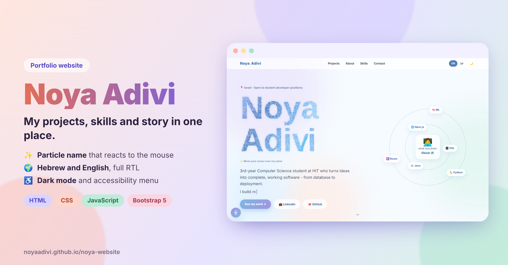

<p align="center">
  <a href="https://noyaadivi.github.io/noya-website"></a>
</p>

<p align="center"><a href="README.he.md"></a></p>

<p align="center">
  <a href="https://noyaadivi.github.io/noya-website"></a>
  <a href="index.html"></a>
  <a href="https://www.linkedin.com/in/noya-adivi/"></a>
</p>

<p align="center">
  <a href="LICENSE"></a>
  <a href="https://github.com/NoyaAdivi/noya-website/commits/main"></a>
  <a href="https://github.com/NoyaAdivi/noya-website"></a>
  <a href="https://github.com/NoyaAdivi/noya-website"></a>
</p>

<h3 align="center">Projects, skills and a little about me, in one place.</h3>

<p align="center">
  A soft pastel design, a particle name that reacts to the mouse, and a full accessibility menu.
</p>

<p align="center">
  <a href="https://noyaadivi.github.io/noya-website"></a>
</p>

<table align="center">
  <tr>
    <td align="center" width="25%"><a href="#projects-on-the-site"><b>🚀 7</b></a><br><sub>projects on the site</sub></td>
    <td align="center" width="25%"><a href="https://noyaadivi.github.io/noya-website"><b>🌍 HE · EN</b></a><br><sub>bilingual, RTL ready</sub></td>
    <td align="center" width="25%"><a href="https://noyaadivi.github.io/noya-website"><b>🌙 Dark</b></a><br><sub>dark mode</sub></td>
    <td align="center" width="25%"><a href="index.html"><b>📄 1</b></a><br><sub>file, no build step</sub></td>
  </tr>
</table>

<a name="projects-on-the-site"></a>
<p align="center"><a href="https://noyaadivi.github.io/noya-website/#projects"></a></p>

- 🗺️ **[Okeat](https://github.com/NoyaAdivi/Okeat)** - bilingual map of 20,000+ eateries · [live](https://okeat.vercel.app)
- 🏨 **[DiviStay](https://github.com/NoyaAdivi/DiviStay)** - group hotel booking with payment splitting · [live](https://divistay.onrender.com)
- 🖼️ **[Sort Photos](https://github.com/NoyaAdivi/sort-photos)** - offline AI photo classifier with CLIP
- 🎭 **[Emotion Detection](https://github.com/NoyaAdivi/emotion_detection_ml)** - Naive Bayes from scratch for 6 emotions
- 💬 **[TCP Chat](https://github.com/NoyaAdivi/Networking-project)** - multi-client chat with Wireshark analysis

<a name="what-s-inside"></a>
<p align="center"><a href="index.html"></a></p>

- 🎨 **Interactive particle name** that reacts to the mouse
- 🌍 **Hebrew and English** with a full right-to-left layout
- 🔍 **Project deep dives** for Okeat and DiviStay: the problem, how it works and the main decisions
- 🗂️ **Project filters** and clickable cards that open each live site or repository
- 🌙 **Dark mode** that follows the system setting
- ♿ **Accessibility menu:** text size, high contrast, readable font and pausing animations
- 📱 **Responsive** from phones to wide screens

<a name="built-with"></a>
<p align="center"><a href="https://getbootstrap.com"></a></p>

A single `index.html` file with HTML, CSS, JavaScript and Bootstrap 5, hosted on GitHub Pages. No build step.

<a name="run-locally"></a>
<p align="center"><a href="LICENSE"></a></p>

```bash
git clone https://github.com/NoyaAdivi/noya-website.git
```
Then open `index.html` in your browser.

<a name="contact"></a>
<p align="center"><a href="https://www.linkedin.com/in/noya-adivi/"></a></p>

<p align="center">
  <a href="https://noyaadivi.github.io/noya-website"></a>
  <a href="https://www.linkedin.com/in/noya-adivi/"></a>
  <a href="https://noyaadivi.github.io/noya-website"></a>
  <a href="https://github.com/NoyaAdivi"></a>
</p>
